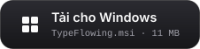
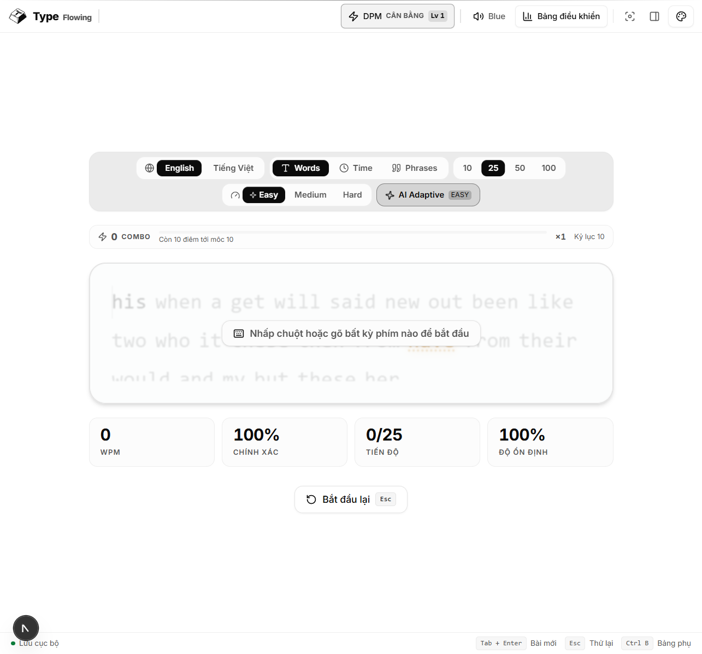
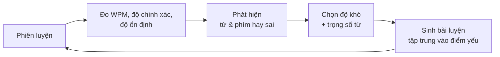
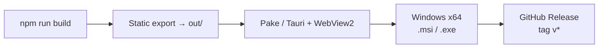

<div align="center">


# TypeFlowing

**Luyện gõ tiếng Việt & English theo lộ trình thích ứng — hoạt động hoàn toàn ngoại tuyến.**

Ứng dụng luyện gõ phím đo tốc độ, độ chính xác và độ ổn định theo thời gian thực,
rồi tự điều chỉnh độ khó cùng danh sách từ dựa trên chính lỗi bạn hay mắc.

<br />

[](https://nextjs.org)
[](https://react.dev)
[](https://www.typescriptlang.org)
[](https://tailwindcss.com)
[](https://tauri.app)
[](#ứng-dụng-desktop-windows)
[](#)
[](#dữ-liệu--quyền-riêng-tư)

[](https://github.com/huyng-dev/type-flowing/stargazers)
[](https://github.com/huyng-dev/type-flowing/releases/latest)
[](https://github.com/huyng-dev/type-flowing/releases)
[](https://github.com/huyng-dev/type-flowing/commits/master)
[](https://github.com/huyng-dev/type-flowing/actions/workflows/build-desktop.yml)

<br />

<a href="https://typeflowing.netlify.app/"></a>
&nbsp;&nbsp;
<a href="https://github.com/huyng-dev/type-flowing/releases/latest/download/TypeFlowing.msi"></a>

</div>

---

## Mục lục

- [TypeFlowing là gì?](#typeflowing-là-gì)
- [Điểm nổi bật](#điểm-nổi-bật)
- [Tải về](#tải-về)
- [Vòng lặp học thích ứng](#vòng-lặp-học-thích-ứng)
- [Công nghệ sử dụng](#công-nghệ-sử-dụng)
- [Cài đặt & chạy bản web](#cài-đặt--chạy-bản-web)
- [Ứng dụng desktop Windows](#ứng-dụng-desktop-windows)
- [Phím tắt](#phím-tắt)
- [Cấu trúc thư mục](#cấu-trúc-thư-mục)
- [Dữ liệu & quyền riêng tư](#dữ-liệu--quyền-riêng-tư)
- [Đóng góp](#đóng-góp)
- [Giấy phép](#giấy-phép)
- [Lời cảm ơn](#lời-cảm-ơn)

## TypeFlowing là gì?

TypeFlowing là một **phòng luyện gõ phím** dành cho người Việt, chạy được cả trên trình duyệt lẫn dưới dạng **ứng dụng desktop Windows**. Điểm khác biệt không nằm ở việc "đo WPM" — mà ở chỗ ứng dụng **học từ lỗi của bạn**:

- Gõ xong một phiên, thuật toán thích ứng sẽ phân tích **từ hay gõ sai**, **phím hay gõ sai** và **độ ổn định theo thời gian**.
- Phiên tiếp theo **tự đổi độ khó** và **ưu tiên lặp lại** đúng những từ bạn còn yếu.
- Song song đó là một lớp động lực (XP, cấp độ, combo, huy hiệu, chuỗi ngày) để việc luyện tập đều đặn trở nên dễ chịu hơn.

**Dành cho ai?** Người muốn gõ nhanh và chính xác hơn với tiếng Việt có dấu (Telex/VNI), người đang luyện tiếng Anh, hoặc bất kỳ ai cần một công cụ luyện tập riêng tư — không tài khoản, không gửi dữ liệu đi đâu.

## Điểm nổi bật

| Tính năng | Mô tả |
| :-- | :-- |
| **Ba chế độ luyện** | `Words` (theo số từ: 10 / 25 / 50 / 100), `Time` (đếm ngược) và `Phrases` (theo cụm từ). |
| **Hai ngôn ngữ** | **Tiếng Việt** (xử lý đúng dấu, hỗ trợ bộ gõ Telex/VNI qua IME) và **English**. |
| **Số liệu thời gian thực** | WPM, độ chính xác, tiến độ hoặc thời gian còn lại, và **độ ổn định** — cập nhật ngay khi gõ. |
| **Combo & hệ số điểm** | Mốc combo 10 / 25 / 50 / 100 với hệ số thưởng lên tới **×2.5**; gõ sai là mất chuỗi. |
| **AI thích ứng** | Tự đánh giá kỹ năng, gợi ý độ khó và tạo bài luyện tập trung vào những từ bạn hay gõ sai. |
| **AI Coach** | Nhận xét cá nhân hoá bằng tiếng Việt trong lúc gõ và trong bảng phân tích. |
| **35 huy hiệu** | Từ tốc độ, độ chính xác, độ ổn định, combo, chuỗi ngày đến các mốc đặc biệt. |
| **XP, cấp độ & nhiệm vụ ngày** | Hệ thống cấp bậc từ *Người mới* tới *Huyền thoại*, kèm nhiệm vụ làm mới mỗi ngày. |
| **Bảng thống kê** | Heatmap hoạt động, ảnh chụp kỹ năng, phím và từ hay sai, kỷ lục cá nhân, nhật ký phiên. |
| **13 giao diện** | Từ Minimal Light (mặc định), Forest Green, Midnight tới Cyberpunk Neon, Retro Terminal… |
| **Gói âm thanh** | Ba bộ tiếng bàn phím cơ (Blue / Brown / Red) và hiệu ứng hạt cho từ "vàng". |
| **Riêng tư tuyệt đối** | Không backend, không tài khoản — toàn bộ dữ liệu lưu cục bộ và chạy offline. |

<div align="center">



*Màn hình luyện gõ: vùng gõ nằm giữa màn hình, số liệu thời gian thực ở ngay bên dưới.*

</div>

## Tải về

**Bản web (không cần cài đặt):** [typeflowing.netlify.app](https://typeflowing.netlify.app/)

Bản dựng sẵn cho **Windows x64** nằm ở [trang Releases](https://github.com/huyng-dev/type-flowing/releases/latest). Hai file trong mục **Assets**:

| File | Khi nào dùng | Tải trực tiếp |
| :-- | :-- | :-- |
| `TypeFlowing.msi` | Cài đặt chuẩn qua Windows Installer — có shortcut trong Start Menu, gỡ cài trong *Apps & features* | [**TypeFlowing.msi**](https://github.com/huyng-dev/type-flowing/releases/latest/download/TypeFlowing.msi) |
| `TypeFlowing.exe` | Bản **portable** — chạy trực tiếp, không cần cài đặt | [**TypeFlowing.exe**](https://github.com/huyng-dev/type-flowing/releases/latest/download/TypeFlowing.exe) |

**Yêu cầu:** Windows 10/11 64-bit và **WebView2 Runtime** (đã có sẵn trên Windows 11 và hầu hết Windows 10).

> Bản dựng hiện **chưa ký số**, nên Windows SmartScreen có thể cảnh báo *"Windows protected your PC"* ở lần chạy đầu — chọn **More info → Run anyway**. Muốn tự build? Xem [Ứng dụng desktop Windows](#ứng-dụng-desktop-windows).

## Vòng lặp học thích ứng

Đây là phần "não" của ứng dụng — mỗi phiên gõ đều nuôi cho phiên tiếp theo:



**Luồng cài đặt và đóng gói:**



## Công nghệ sử dụng

| Lớp | Công nghệ |
| :-- | :-- |
| **Framework** | Next.js 15 (App Router) + React 19 |
| **Ngôn ngữ** | TypeScript 5 |
| **Giao diện** | Tailwind CSS 4, Radix UI, `lucide-react`, `tw-animate-css` |
| **Đóng gói web** | `output: "export"` — xuất tĩnh ra thư mục `out/` |
| **Ứng dụng desktop** | [Pake](https://github.com/tw93/Pake) (Tauri + WebView2) |
| **Lưu trữ** | `localStorage` — không server, không cơ sở dữ liệu |

## Cài đặt & chạy bản web

**Bản web đang chạy sẵn tại [typeflowing.netlify.app](https://typeflowing.netlify.app/)** — mở là dùng, không cần cài đặt gì.

Chạy trên máy của bạn:

**Yêu cầu:** Node.js 18 trở lên (khuyến nghị 20/22) và npm.

```bash
# 1. Cài phụ thuộc
npm install

# 2. Chạy ở chế độ phát triển
npm run dev
# mở http://localhost:3000

# 3. Kiểm tra kiểu và lint
npx tsc --noEmit
npm run lint

# 4. Xuất bản tĩnh (dùng cho hosting hoặc đóng gói desktop)
npm run build
# kết quả nằm trong thư mục out/
```

Thư mục `out/` là một site tĩnh hoàn chỉnh, có thể deploy lên GitHub Pages, Netlify, Vercel hoặc bất kỳ máy chủ tĩnh nào.

## Ứng dụng desktop Windows

Ứng dụng desktop được tạo bằng **Pake** (Tauri + WebView2) từ chính bản export tĩnh — nhẹ, khởi động nhanh, không kèm Chromium.

**Cách 1 — Tải bản dựng sẵn (nhanh nhất):**

Vào [trang Releases](https://github.com/huyng-dev/type-flowing/releases/latest) và chọn file theo bảng ở mục [Tải về](#tải-về).

**Cách 2 — Build qua GitHub Actions (không cần cài Rust):**

1. Đẩy một tag phiên bản để vừa build vừa tạo Release:
   ```bash
   git tag v1.0.0
   git push origin v1.0.0
   ```
   Hoặc chạy thủ công ở **Actions → Build desktop app → Run workflow** (cách này chỉ tạo artifact, không tạo Release).
2. Workflow sẽ xuất bản tĩnh, đóng gói bằng Pake rồi:
   - đính kèm `.msi` / `.exe` vào **GitHub Release** nếu bạn đẩy tag;
   - luôn lưu thêm artifact **`typeflowing-1.0-windows-x64`** trong trang của lần chạy.
3. Giải nén và chạy file `.msi` hoặc `.exe`.

> **Phân biệt nhanh:** *artifact* là bản nháp trong tab Actions (chỉ chủ repo thấy, GitHub có thể xoá sau ~90 ngày). *Release* là bản công khai, có link tải vĩnh viễn — đây mới là thứ nên đưa cho người dùng.

**Cách 3 — Build tại máy (cần Rust + Visual Studio Build Tools):**

```bash
npm run build
npm install --global pake-cli
pake ./out --name TypeFlowing --identifier com.typeflowing.app \
  --app-version 1.0.0 --icon ./desktop/icon.png \
  --width 1360 --height 900 --min-width 1080 --min-height 680 \
  --targets x64 --keep-binary
```

Cửa sổ mặc định **1360 × 900** (tối thiểu 1080 × 680) để bảng **Inspector** hiển thị song song bên cạnh vùng gõ.

## Phím tắt

| Phím | Tác dụng |
| :-- | :-- |
| `Ctrl` / `Cmd` + `B` | Bật hoặc tắt bảng **Inspector** (tiến độ, nhiệm vụ, phiên gần đây) |
| `Esc` hoặc `Tab` + `Enter` | Bắt đầu lại / tạo bài mới |
| `Backspace` | Quay lại từ trước đó |
| Bất kỳ phím | Bắt đầu gõ khi vùng luyện chưa được kích hoạt |

## Cấu trúc thư mục

```
type-flow/
├─ app/                       # App Router: shell, layout, token giao diện
│  ├─ page.tsx                # Màn hình luyện gõ (khung desktop)
│  ├─ globals.css             # Token thiết kế + keyframes (brandWave...)
│  └─ layout.tsx
├─ components/
│  ├─ dashboard/              # Bảng thống kê: heatmap, kỹ năng, huy hiệu, nhật ký
│  ├─ ui/                     # Thành phần Radix/Tailwind dùng chung
│  ├─ combo-meter.tsx         # Thanh combo + hệ số
│  ├─ test-result.tsx         # Tổng kết phiên (bento)
│  ├─ practice-sidebar.tsx    # Bảng Inspector
│  ├─ theme-selector.tsx      # Bộ chọn giao diện có xem trước
│  └─ feedback-layer.tsx      # Hiệu ứng hạt, từ vàng, rung
├─ lib/                       # Logic thuần: thuật toán, dữ liệu, âm thanh
│  ├─ adaptive-algorithm.ts   # AI thích ứng & AI Coach
│  ├─ achievements-data.ts    # 35 huy hiệu
│  ├─ engagement.ts           # XP, cấp độ, nhiệm vụ ngày
│  ├─ scoring-system.ts       # Điểm, kỷ lục, chuỗi ngày
│  ├─ dopamine.ts             # Combo, hệ số, chế độ DPM
│  ├─ languages.ts            # Cấu hình English / Tiếng Việt
│  └─ themes.ts               # 13 giao diện
├─ public/sounds/             # Gói âm thanh bàn phím cơ
├─ desktop/                   # Icon ứng dụng desktop
├─ scripts/                   # Script hỗ trợ build
├─ assets/readme/             # Hình ảnh cho README này
└─ .github/workflows/         # CI: build ứng dụng desktop Windows
```

## Dữ liệu & quyền riêng tư

- **Không có máy chủ, không có tài khoản.** Mọi thứ (kỷ lục, huy hiệu, XP, lịch sử phiên, cài đặt) đều nằm trong `localStorage` của trình duyệt / WebView trên máy bạn.
- **Chạy hoàn toàn ngoại tuyến.** Sau lần tải đầu tiên, ứng dụng không cần Internet.
- **Bạn kiểm soát dữ liệu.** Có thể xuất toàn bộ thống kê ra JSON (`typeflow-stats-YYYY-MM-DD.json`) từ bảng thống kê.
- Xoá dữ liệu trình duyệt hoặc bộ nhớ ứng dụng sẽ xoá luôn tiến độ luyện tập.
- Bản desktop dùng **hồ sơ WebView2 riêng**, không dùng chung dữ liệu với bản web trên cùng máy.

## Đóng góp

Mọi ý tưởng và báo lỗi đều được hoan nghênh:

1. Fork kho mã nguồn.
2. Tạo nhánh: `git checkout -b feature/ten-tinh-nang`.
3. Commit theo [Conventional Commits](https://www.conventionalcommits.org/) (`feat:`, `fix:`, `docs:`…).
4. Mở Pull Request mô tả rõ thay đổi.

Nếu gặp lỗi, vui lòng mở [Issue](https://github.com/huyng-dev/type-flowing/issues) kèm trình duyệt hoặc phiên bản Windows và các bước tái hiện.

## Giấy phép

Kho mã nguồn hiện **chưa kèm tệp giấy phép chính thức**. Nếu bạn muốn dùng lại, phân phối hoặc đóng góp, hãy liên hệ trước qua [Issue](https://github.com/huyng-dev/type-flowing/issues) để thống nhất điều khoản.

## Lời cảm ơn

- [mechvibes](https://github.com/hainguyents13/mechvibes) — nguồn của các gói âm thanh bàn phím cơ (Blue / Brown / Red) được dùng trong ứng dụng.
- [Next.js](https://nextjs.org), [React](https://react.dev), [Tailwind CSS](https://tailwindcss.com) và [Radix UI](https://www.radix-ui.com) — nền tảng giao diện.
- [Pake](https://github.com/tw93/Pake) và [Tauri](https://tauri.app) — lớp đóng gói ứng dụng desktop.
- [beautify-github-readme](https://github.com/oil-oil/beautify-github-readme) — nguồn cảm hứng cho bố cục README này.

<div align="center">

<sub>Được xây dựng với sự tập trung vào <strong>tiếng Việt</strong> — luyện mỗi ngày một chút, gõ nhanh và chuẩn hơn.</sub>

</div>
